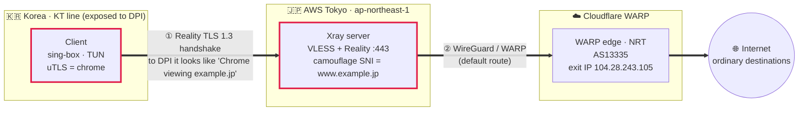
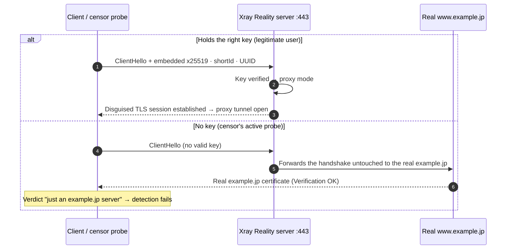
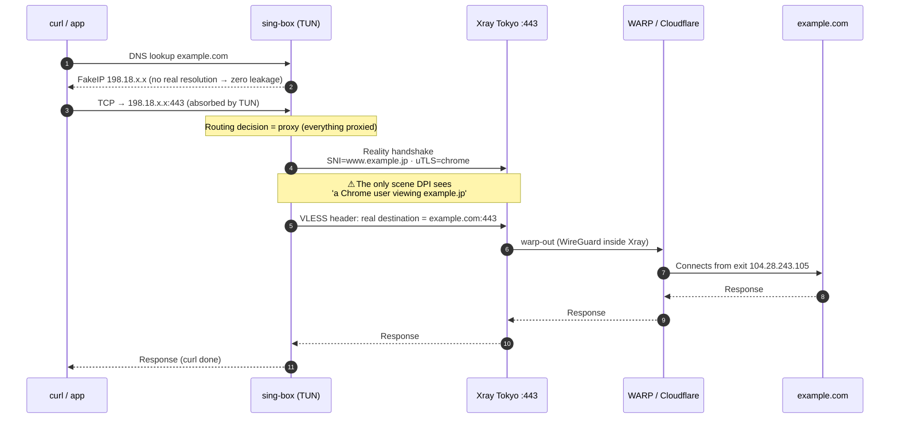

> ℹ️ **About the example values**: **The server IP (`203.0.113.10`), the camouflage SNI domain (`www.example.jp`), the Reality public key, the shortId and the client UUID in this post are all documentation placeholders** (the IP comes from `203.0.113.0/24`, the range RFC 5737 reserves for documentation, and `example.jp` is a domain JPRS reserves for documentation). If you build this yourself, replace them with your own values. **Never publish your private keys (privateKey/secretKey).** **The certificate and SNI bytes in the PoC are illustrative values based on this example domain** (in practice, the genuine certificate of whichever camouflage domain you choose comes back unchanged). On the other hand, **the exit IP, the performance numbers and the traffic flows are real measurements taken from a live setup**, and the exit IP belongs to a Cloudflare WARP range shared by a huge number of users, so it identifies neither the server nor any individual.

## 1. A journey toward using the internet freely

The motivation is simple: **I want to use the internet safely, freely and anonymously.** So I built a proxy system with VLESS + Xray + Reality + WARP, and this post is based on three months of running it.

Internet regulation in Korea gets tighter every year — blocking has already gone past the DNS level to **reading the destination name (SNI) in plaintext**, and its scope keeps widening. Nor is this only a Korean story. China's Great Firewall (GFW) and Russia's "sovereign internet" are much further down the same road. What plays out in every one of these places is an endless **battle between spear and shield** — someone gets around a restriction, a new restriction appears to stop that, and then a way around that one appears. There is a hint in that.

First, you need to know how modern censorship works. Censorship today is not a simple blacklist along the lines of "block this domain." ISP middleboxes **judge traffic by its "shape"**:

1. **Packet signatures** — they identify a protocol's unique fingerprint (WireGuard's handshake has a fixed structure, so it is caught in one shot).
2. **Plaintext SNI** — they read the destination name of a TLS connection as-is.
3. **Behavioral patterns** — they flag long-lived sessions to unknown IPs that don't look like browsing as anomalies.

The signs are already here. Run a self-hosted VPN in Korea for a few days and **only the persistent TLS sessions get picked out** and dropped (EOF), while WireGuard and OpenVPN are often blocked right at the handshake. It isn't a bandwidth problem; it's that the traffic's "shape" differs from an ordinary user's.

So the goal is clear.

> **"When a censor looks at my traffic, it must not differ by a single bit from an ordinary person viewing a well-known site over HTTPS."**

What creates this "indistinguishability" is **Reality**. And to erase **who is connecting from where** as well, the final exit is anonymized once more through **Cloudflare WARP**. All so that I can just use the internet, without being watched or controlled by anyone.

> 📎 **Reference** — [*How I Hid My VPN*](https://youtu.be/v7Pal3AQyVM)

---

## 2. Overall architecture



**Two key design choices:**

1. **The censored leg (client ↔ Tokyo server)** is wrapped in Reality and disguised as *normal TLS 1.3 to a well-known Japanese site*.
2. WireGuard (WARP) is used **only on the uncensored leg (Tokyo server ↔ Cloudflare)**. → This takes the benefit of "laundering the exit IP" without exposing WireGuard's fingerprint problem to the censoring network.

> **Why put WARP at the end?** The IP the final destination sees becomes **Cloudflare (AS13335)** instead of **AWS (AS16509)**. AWS ranges are easily blocked as "data center = suspected bot/proxy," but WARP edge IPs are consumer ranges shared by huge numbers of real users, so their reputation is good. The point is that **not even my server's IP is exposed to the final destination.**

---

## 3. The weaknesses of a conventional WireGuard VPN

WireGuard is fast, small in code and cryptographically excellent, but **as a censorship circumvention tool it has fatal weaknesses**.

| Weakness | Description | What DPI does |
|---|---|---|
| **Fixed handshake fingerprint** | The Handshake Initiation is **exactly 148 bytes**, followed by a Responder message of **exactly 92 bytes**. The first 4 bytes of every packet carry the message type (`0x01` init, `0x02` response …) in the clear. There is no obfuscation at all. | A single rule, `148-byte → 92-byte UDP flow`, catches almost every WireGuard handshake |
| **UDP-based** | Many censoring and corporate networks throttle 443/UDP outright, or drop unidentified UDP that isn't QUIC. | Blocks "high-volume, long-lived UDP" itself without even knowing the protocol |
| **Vulnerable to active probing** | Anyone can throw a WG handshake at it, and the server either responds or stays silent → the response pattern identifies the server. | Fires probe packets at a suspicious IP:port → confirms a VPN server, then blacklists it |
| **No camouflage or cover traffic** | There is no notion of SNI camouflage, certificate camouflage or mimicking normal traffic at all. Even moved to port 443, the payload isn't TLS, so it gives itself away immediately. | "Port 443 but not TLS" → flagged as an anomaly |
| **Identified instantly once exposed** | The protocol's identity shows plainly in the traffic, so once an endpoint is singled out it stays blocked for good. | Listed in IP reputation databases |

As of 2026, commercial DPI appliances from Sandvine, Allot and Huawei **ship with WireGuard detection rules built in**, and the latest middleboxes identify WireGuard without decrypting it, from as few as 100 packets, using ML classification based on timing and entropy. The real-world blocking record is grim — **vanilla WireGuard succeeds about 12% of the time in Russia, suffers 98% packet loss in Iran, and is caught within seconds by China's GFW**, and more than ten other countries, including Turkey, Belarus and Myanmar, block or throttle it at the DPI level.

> This is why "obfuscated WireGuard" derivatives such as **AmneziaWG** have appeared. They pad vanilla WireGuard's fixed packet sizes with random junk and variable headers to scatter the signature, which is itself evidence that the industry has conceded *"WireGuard gets caught if you use it as-is."* The Reality setup in this post goes one step further: it looks not like **"something obfuscated" but like "plain, normal TLS itself."**

**In short**: WireGuard connects by shouting *"I am WireGuard!"* The censor only needs ears to hear it. Reality, by contrast, says *"I'm just someone browsing example.jp,"* and **presents the real example.jp TLS certificate as proof** (demonstrated in sections 4 and 5 below).

---

## 4. Components

### 4.1 VLESS

VLESS is the successor to VMess, and it **strips out the built-in encryption and timestamp authentication.** Why? Because the outside will be wrapped in TLS 1.3 (Reality) anyway, so double encryption is a waste of CPU. The VLESS header is no more than a **thin 25–50-byte routing header** made up of roughly a version byte, a UUID, a command and the destination address (compared with 100+ bytes for OpenVPN). On top of that, the `xtls-rprx-vision` flow suppresses the telltale record-size pattern that TLS-in-TLS produces.

> 📎 **Reference** — An article that dissects VLESS byte by byte as a "minimal TLS 1.3 wrapper" and lays out DPI's three main detection techniques (protocol fingerprinting, statistical analysis, active probing): [habr.com/en/articles/990144](https://habr.com/en/articles/990144/) (sections 1 and 3).

### 4.2 Xray-core — the server engine

What actually runs on the server is Xray.

```console
$ xray version
Xray 26.3.27 (Xray, Penetrates Everything.) — go1.26.1 linux/amd64
$ ps -o etime,cmd -C xray
   ELAPSED CMD
30-13:49:26 /usr/local/bin/xray run -config /usr/local/etc/xray/config.json   # 30 days without interruption
```

It has been running for 30 days without interruption as `nobody`.

### 4.3 Reality — the heart of this setup

The fundamental problem with conventional TLS camouflage (TLS + a web server, e.g. Trojan) is that **"the certificate I present is not the real thing."** If a censor digs through the Certificate Transparency logs or verifies the certificate chain, the self-made domain gives itself away.

**Reality's change of approach:**

- My server **does not issue or present a certificate of its own.**
- Instead, it **"borrows" a real, well-known site (here, `www.example.jp`).**
- When a legitimate client (one holding the right x25519 key + shortId) connects → Xray operates in proxy mode.
- **When anyone without the key (= a censor's active probe) connects → Xray forwards that handshake untouched to the real `www.example.jp:443`**, and the client receives example.jp's genuine certificate.

Here is that "legitimate user ↔ censor probe" branch as a diagram:



In other words, however hard the censor pokes at it, the only conclusion it can reach is **"this is just an example.jp server."**

> 📎 **Reference (how Reality works)** — the official implementation [XTLS/REALITY](https://github.com/XTLS/REALITY), the documentation on SNI fallback camouflage [Project X — Fallbacks with SNI](https://xtls.github.io/en/document/level-1/fallbacks-with-sni.html), and a source-level analysis [How REALITY works (ObjShadow)](https://objshadow.pages.dev/en/posts/how-reality-works/). For a discussion of defending against active probing, see [Xray-core Discussion #2623](https://github.com/XTLS/Xray-core/discussions/2623).

**Server inbound configuration:**

```jsonc
{
  "tag": "vless-reality-in",
  "listen": "0.0.0.0", "port": 443,
  "protocol": "vless",
  "settings": {
    "clients": [{ "id": "<client-UUID>", "flow": "xtls-rprx-vision" }],
    "decryption": "none"
  },
  "streamSettings": {
    "network": "tcp",
    "security": "reality",
    "realitySettings": {
      "dest": "www.example.jp:443",        // camouflage target (handshakes really are forwarded here)
      "serverNames": ["www.example.jp"],   // allowed SNI
      "privateKey": "<xray-x25519-private-key>",   // never publish
      "shortIds": ["", "0123456789abcdef"]
    }
  },
  "sniffing": { "enabled": true, "destOverride": ["http","tls","quic"], "routeOnly": true }
}
```

> **How to choose the camouflage target (dest)** — Not just any site will do. It looks natural only if ① it supports TLS 1.3 + X25519 and ② it sits in **the same cloud/ASN/region** as the server. For a server on AWS Tokyo, picking **a large Japanese site hosted on AWS (→ whose certificate issuer shows up as `Amazon`)** makes the camouflage far more natural (same cloud and ASN as the server). This post writes the camouflage domain as the documentation example `www.example.jp`. In practice, when KT's DPI flagged the proxy IP, matching the SNI to **a host in the same region and ASN as the server** was decisive for stability.

### 4.4 WARP outbound — laundering the exit

The server's default exit is not `direct` (which exposes the AWS IP) but **Cloudflare WARP (userspace WireGuard)**.

```jsonc
{
  "tag": "warp-out",
  "protocol": "wireguard",
  "settings": {
    "secretKey": "<WARP-private-key>",
    "address": ["172.16.0.2/32", "2606:4700:110:84e7:...../128"],
    "peers": [{
      "publicKey": "bmXOC+F1FxEMF9dyiK2H5/1SUtzH0JuVo51h2wPfgyo=",
      "endpoint": "engage.cloudflareclient.com:2408",
      "allowedIPs": ["0.0.0.0/0", "::/0"],
      "keepAlive": 25
    }],
    "mtu": 1280
  }
}
```

The important point here: **this WireGuard is a userspace implementation inside Xray**, so it does not show up as a kernel interface (`wg show`), and it **flows only on the AWS ↔ Cloudflare leg (the uncensored overseas leg)**. That is, it takes only the benefit of "exit IP = Cloudflare" while never exposing WireGuard's fingerprint problem to Korea's censoring network.

### 4.5 Routing — hardening

```jsonc
"routing": {
  "rules": [
    { "ip": ["geoip:private"], "outboundTag": "block" },      // block SSRF / internal network scans
    { "protocol": ["bittorrent"], "outboundTag": "block" },   // prevent abuse (protects IP reputation)
    { "ip": ["203.0.113.10/32"], "port": "22",   "outboundTag": "loopback-ssh" },      // for administration
    { "ip": ["203.0.113.10/32"], "port": "8080", "outboundTag": "loopback-speedtest" },
    { "network": "tcp,udp", "outboundTag": "warp-out" }       // everything else → WARP
  ]
}
```

- **`geoip:private` → block**: shuts out SSRF-style scanning of internal networks through the proxy at the source.
- **bittorrent → block**: keeps torrent-driven abuse reports from killing the reputation of the WARP/AWS IPs.
- **loopback-ssh**: instead of opening a separate port, the server's own port 22 is reached from inside the proxy tunnel (so admin traffic stays disguised too).

### 4.6 Client — sing-box (TUN + FakeIP)

The client runs sing-box in TUN mode, transparently swallowing **all of the system's traffic**.

```jsonc
{
  "outbounds": [{
    "type": "vless",
    "server": "203.0.113.10", "server_port": 443,
    "uuid": "<client-UUID>",
    "flow": "xtls-rprx-vision",
    "tls": {
      "enabled": true,
      "server_name": "www.example.jp",
      "reality": { "enabled": true,
        "public_key": "<server-Reality-public-key>",
        "short_id": "0123456789abcdef" },
      "utls": { "enabled": true, "fingerprint": "chrome" }   // ← disguise as Chrome
    }
  }],
  "dns": { "servers": [
    { "tag": "proxy-dns", "type": "https", "server": "1.1.1.1", "detour": "proxy" },  // DoH on the far side of the proxy
    { "tag": "fakeip", "type": "fakeip", "inet4_range": "198.18.0.0/15" }             // prevents DNS leaks
  ]}
}
```

Two things matter most here.

- **`utls: chrome`** — generates a TLS ClientHello identical to a real Chrome browser's fingerprint (proven with packets later on). uTLS is the [refraction-networking/utls](https://github.com/refraction-networking/utls) library, which imitates a specific browser's fingerprint in place of the telltale fingerprint of Go's standard TLS.
- **FakeIP + DoH-over-proxy** — domains are never resolved locally. A fake `198.18.x` IP is returned immediately and the real resolution happens on the far side of the proxy, so **DNS leakage is zero**.

---

## 5. PoC — proof at the packet level

**Real commands and real responses.** Each test checks whether the setup holds up against one of the censor's three approaches: ① tracing the exit IP, ② active probing, ③ passive packet observation.

### PoC-1. Confirming the exit IP is laundered

```console
$ curl -s https://api.ipify.org
104.28.243.105

$ curl -s https://www.cloudflare.com/cdn-cgi/trace | grep -E '^(ip|warp|colo|loc)='
ip=2a09:bac5:4305:dc::16:175
colo=NRT
loc=JP
warp=on

$ curl -s "http://ip-api.com/line/?fields=query,country,city,isp,as"
104.28.243.105
Japan
Tokyo
Cloudflare, Inc.
AS13335 Cloudflare, Inc.
```

**Interpretation:**

| Viewpoint | Actual value | What the destination sees |
|---|---|---|
| My real location | Korea, KT | ❌ Not visible |
| Proxy server | `203.0.113.10` (AWS, **AS16509**, Tokyo) | ❌ Not visible |
| **Exit the destination sees** | — | ✅ `104.28.243.105` (**Cloudflare AS13335**, Tokyo) |

`warp=on` confirms the traffic goes through WARP. It passed through three hops (Korea → proxy server → WARP), yet the final destination sees only **a Cloudflare consumer range**. **The proxy server's IP is never exposed.**

### PoC-2. Resisting active probing — "poke it all you like, it's just example.jp"

Suppose a censor connects directly to the suspicious IP `203.0.113.10:443`, using openssl with no credentials:

```console
$ echo | openssl s_client -connect 203.0.113.10:443 -servername www.example.jp 2>/dev/null \
      | openssl x509 -noout -subject -issuer -dates
subject=CN=www.example.jp
issuer=C=US, O=Amazon, CN=Amazon RSA 2048 M01
notBefore=Jan 19 00:00:00 2026 GMT
notAfter=Jan 14 23:59:59 2027 GMT

# For comparison: connecting directly to the real www.example.jp
$ echo | openssl s_client -connect www.example.jp:443 -servername www.example.jp 2>/dev/null \
      | openssl x509 -noout -subject -issuer
subject=CN=www.example.jp
issuer=C=US, O=Amazon, CN=Amazon RSA 2048 M01

# TLS parameters
$ echo | openssl s_client -connect 203.0.113.10:443 -servername www.example.jp 2>/dev/null \
      | grep -E 'Protocol|Cipher|Verification'
Verification: OK
New, TLSv1.3, Cipher is TLS_AES_128_GCM_SHA256
Protocol: TLSv1.3
```

**Interpretation: identical in every respect.**

- The certificate the proxy server returned: `CN=www.example.jp`, issued by `Amazon RSA 2048 M01`.
- The certificate the real example.jp returns: **exactly the same.**
- `Verification: OK` — a self-made certificate would have failed chain verification, but this one passes because it is **the real certificate of the real example.jp**.

However much a censor actively probes this IP, the only conclusion it gets is **"this is an example.jp server."** Had it been a WireGuard server, a single probe would have given it away.

### PoC-3. Passive observation — the bytes DPI actually reads on the wire

This time, suppose the censor simply eavesdrops on packets in the middle of the line. I capture the traffic leaving the client's physical NIC (`eth0`) for the server with `tshark`, and meanwhile fire curl at several sites to trigger **new upstream connections (= new Reality handshakes)**.

```console
$ tshark -i eth0 -f "host 203.0.113.10 and tcp port 443" -w reality.pcap &
$ for h in example.com www.wikipedia.org api.ipify.org neverssl.com; do
      curl -s -o /dev/null "https://$h/?cachebust=$RANDOM"; done
```

**(3-a) The SNI and TLS version DPI sees:**

```console
$ tshark -r reality.pcap -Y "tls.handshake.type==1" \
    -T fields -e frame.number -e ip.dst -e tcp.dstport \
    -e tls.handshake.extensions_server_name -e tls.handshake.ja3_full
```

| frame | ip.dst | port | SNI | Extension order |
|---|---|---|---|---|
| 31  | 203.0.113.10 | 443 | **www.example.jp** | `0-45-17613-16-11-35-18-5-27-51-13-23-10-65037-65281-43` |
| 73  | 203.0.113.10 | 443 | **www.example.jp** | `18-35-65281-16-11-17613-65037-5-13-43-51-45-10-23-0-27` |
| 118 | 203.0.113.10 | 443 | **www.example.jp** | `16-23-0-51-13-10-18-5-11-27-17613-45-65037-43-35-65281` |
| 186 | 203.0.113.10 | 443 | **www.example.jp** | `65037-23-43-27-16-51-45-18-5-13-35-10-0-65281-11-17613` |

Two observations:

1. **Every SNI is `www.example.jp`** — the only destination hint DPI can read in plaintext is "example.jp." I actually went to example.com, Wikipedia and ipify, but **none of that leaves a trace on the wire.**
2. **The extension order is shuffled on every connection** — this is no accident; it is uTLS faithfully imitating **the real behavior of Chrome 110+ (randomized extension order)**. The leading cipher suites, `4865-4866-4867` (the three TLS 1.3 AEADs), match Chrome too. In other words, the JA3 fingerprint changes with every connection, so **"fixed-fingerprint matching" can never catch it.** The extension list even carries Chrome-specific extensions such as `65037` (GREASE ECH), `17613` (ALPS) and `27` (compress_certificate).

**(3-b) The wire bytes — the SNI hostname sits there in plaintext:**

```console
# Hostname bytes of the SNI extension inside the ClientHello (frame 31)
0e 77 77 77 2e 65 78 61 6d 70 6c 65 2e 6a 70   ->  "www.example.jp"  (0e = length 14)
```

After the length byte `0e` (14), `77 77 77 2e 65 78 61 6d 70 6c 65 2e 6a 70` = **"www.example.jp"** is carried as-is, in plaintext. **This is everything DPI reads off the line** — byte for byte, it is identical to an ordinary Chrome user opening example.jp.

### PoC-4. Performance

Even across three hops (Korea → Tokyo Reality → Cloudflare WARP), real-world performance is solid.

```console
$ for i in 1 2 3; do curl -s -o /dev/null \
    -w "ttfb=%{time_starttransfer}s total=%{time_total}s\n" \
    https://www.cloudflare.com/cdn-cgi/trace; done
ttfb=0.234s total=0.235s
ttfb=0.258s total=0.259s
ttfb=0.258s total=0.258s

$ curl -s -o /dev/null -w "speed=%{speed_download} bytes/s\n" \
    "https://speed.cloudflare.com/__down?bytes=10000000"
speed=7615746 bytes/s        # ≈ 61 Mbps (10MB in 1.31s)
```

- **TTFB ≈ 235–260 ms** (including the Korea↔Tokyo round trip and the WARP hop). No noticeable impact on browsing.
- **Download ≈ 61 Mbps** (single stream, 3 hops). That's thanks to VLESS dropping double encryption and `xtls-rprx-vision` cutting overhead.

---

## 6. The whole journey (end to end)

Here is what actually happens when you run `curl https://example.com`, as a sequence:



Step by step:

1. **DNS** — sing-box intercepts `example.com` and immediately returns the **FakeIP `198.18.x.x`** (no real resolution → zero leakage).
2. **TUN absorption** — `singbox-tun` swallows the packets headed for `198.18.x.x`.
3. **Routing decision** — `final: proxy`; everything goes to the proxy.
4. **Reality handshake** — sing-box connects to the server at `203.0.113.10:443`. **It uses uTLS to generate a ClientHello with Chrome's fingerprint**, with SNI=`www.example.jp`. The shortId and UUID ride along in the x25519 key exchange to prove to the server that this is "a legitimate client." ← **DPI sees this only as a connection to example.jp.**
5. **VLESS routing** — inside the tunnel, the client tells the server "the real destination is example.com:443."
6. **Server routing** — Xray picks `warp-out`.
7. **WARP egress** — Xray's internal WireGuard hands the packets to the Cloudflare edge (NRT).
8. **Final exit** — Cloudflare connects to example.com from `104.28.243.105`. **The origin sees only a Cloudflare IP.**
9. **Return path** — the response travels back in reverse, 8→1, and reaches curl.

What the censor sees: **a single scene, step 4**, and even that is "a Chrome user viewing example.jp."

---

## 7. Limitations and operational considerations

The weaknesses of this setup, and what could be improved.

- **Traffic correlation**: if a censor can see both ends of the line, timing and volume correlation still leave room for inference. Reality hides only the content and the destination; it does not stop metadata correlation.
- **Camouflage domain risk**: if the site chosen as `dest` goes down or changes its TLS stack, the camouflage starts to look off. Staying in the same ASN/region as the server matters.
- **IP reputation**: WARP exits are shared IPs, so some sites block WARP ranges or show them CAPTCHAs. That is why torrents are blocked, to manage IP reputation.
- **More sophisticated active probes**: a censor could look statistically for "behavior a legitimate example.jp user would not show" (e.g., connecting and then never sending an HTTP request). Reality defends against this well, but the theoretical attack surface is there.
- **Single point of failure**: one server in Tokyo. Multiple servers with automatic failover are future work.

Even so, **from a censorship-circumvention standpoint it is overwhelmingly better than plain WireGuard/OpenVPN**. Where WireGuard "gives itself away in the first packet," the PoCs above demonstrate that this setup **cannot be told apart from normal traffic at any layer — packets, certificates or fingerprints.**

---

## 8. Conclusion

> **The essence of censorship circumvention is not encryption but "indistinguishability."**

WireGuard encrypts traffic perfectly, yet it gets caught because it cannot hide *the very fact that it is encrypted*. Reality survives the opposite way: by **turning my traffic into something the censor can never block (ordinary TLS 1.3 to a well-known site)**. Put WARP on top, and even the exit IP gets laundered.

- **Exit IP** → Cloudflare (even my server's IP is hidden) ✅
- **Active probing** → answered with the real example.jp certificate ✅
- **Passive observation** → plaintext SNI is `www.example.jp`, with a Chrome uTLS fingerprint (shuffled per connection) ✅
- **Performance** → TTFB 250 ms, 61 Mbps ✅

The fight against DPI comes down to a game of *"how closely does my traffic resemble the normal traffic a censor can't bring itself to cut?"* — and this setup is designed to win that game.

---

## References

**Concepts**
- 🎬 [*How I Hid My VPN* (YouTube)](https://youtu.be/v7Pal3AQyVM) — an introduction to the idea from a "concealment, not encryption" angle
- 📄 [VLESS dissected in depth (Habr #990144)](https://habr.com/en/articles/990144/) — analyzes VLESS as a minimal TLS wrapper; DPI's three main detection techniques

**Reality / XTLS**
- [XTLS/REALITY (official repository)](https://github.com/XTLS/REALITY)
- [Project X — Fallbacks with SNI (official documentation)](https://xtls.github.io/en/document/level-1/fallbacks-with-sni.html)
- [How REALITY works — a source-level analysis (ObjShadow)](https://objshadow.pages.dev/en/posts/how-reality-works/)
- [Defending against active probing — Xray-core Discussion #2623](https://github.com/XTLS/Xray-core/discussions/2623)
- [A deep dive into VLESS + Reality + XTLS Vision (Hakim Mhioul)](https://www.mhioul.com/blog/vless-reality-xtls-deep-dive)

**Client / libraries / exit**
- [sing-box official documentation](https://sing-box.sagernet.org)
- [uTLS — refraction-networking/utls](https://github.com/refraction-networking/utls) (browser TLS fingerprint camouflage)
- [Cloudflare WARP client documentation](https://developers.cloudflare.com/warp-client/)

**WireGuard's detectability (the control group)**
- [The Imitation Game — making WireGuard invisible to DPI (NT Kernel)](https://www.ntkernel.com/the-imitation-game-how-modern-solutions-make-wireguard-invisible-to-dpi/)
- [VLESS vs WireGuard/Shadowsocks/Trojan — DPI and speed compared (Proxy Poland)](https://proxypoland.com/blog/vless-vs-wireguard-shadowsocks-trojan-comparison)
- [AmneziaWG 2.0 — self-hosting an obfuscated WireGuard (DEV)](https://dev.to/bivlked/amneziawg-20-self-host-an-obfuscated-wireguard-vpn-that-bypasses-dpi-4692)
- [How DPI detects and blocks VPNs (CrazyPrivacy)](https://www.crazyprivacy.com/2025/10/27/understanding-deep-packet-inspection-dpi-how-isps-detect-and-block-vpn-traffic/)

---
